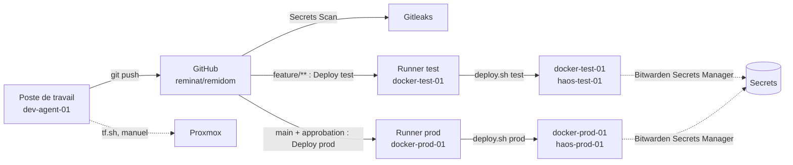

# Architecture générale

## Principes

- Une seule base de code pour `test` et `prod` ; les différences passent par la
  configuration (variables Terraform, inventaires et `group_vars` Ansible).
- Chaque environnement a ses propres VM ; aucune VM n'est partagée entre `test` et `prod`.
- Toujours déployer en `test`, valider, puis promouvoir en `prod`.
- Les secrets ne sont jamais dans le dépôt : ils sont lus dans Bitwarden au moment de
  l'exécution (voir [Sécurité](securite.md)).
- Pas d'outillage lourd (pas de Kubernetes) : Terraform, Ansible, Docker Compose.

## Couches

| Couche | Outil | Rôle | Emplacement |
|---|---|---|---|
| Virtualisation | Proxmox VE | Hôte unique, exécute les VM | [Proxmox](proxmox.md) |
| Provisionnement | Terraform (`bpg/proxmox` `~> 0.93`) | Crée et détruit les VM par clonage de templates | [`infra/terraform/`](../infra/terraform/) |
| Amorçage | cloud-init (VM Ubuntu), script `bootstrap-haos.sh` (HAOS) | Utilisateur, clés SSH, paquets de base | [`infra/proxmox/`](../infra/proxmox/) |
| Configuration | Ansible | Paquets, Docker, déploiement des piles, sauvegardes, runner CI | [`infra/ansible/`](../infra/ansible/) |
| Services | Docker Compose | Pile `core` | [`services/docker/core/`](../services/docker/core/) |
| Domotique | Home Assistant OS | VM dédiée, `configuration.yaml` géré par Ansible | [`services/ha/`](../services/ha/) |
| Sauvegarde | Restic (client et NAS) | Données Docker vers le NAS, maintenance sur le NAS | [Sauvegardes](sauvegardes.md) |
| CI/CD | GitHub Actions, runners auto-hébergés | Scan de secrets, déploiement test et prod | [CI/CD](ci-cd.md) |

## Environnements (Git)

| | test | prod |
|---|---|---|
| Hôte Docker | `docker-test-01` | `docker-prod-01` |
| VM Home Assistant | `haos-test-01` | `haos-prod-01` |
| Domaine de base | `test.reminat.com` | `reminat.com` |
| Inventaire Ansible | [`inventories/test`](../infra/ansible/inventories/test/) | [`inventories/prod`](../infra/ansible/inventories/prod/) |
| Terraform | [`envs/test/pve/`](../infra/terraform/envs/test/pve/) | [`envs/prod/pve/`](../infra/terraform/envs/prod/pve/) |
| Runner GitHub | `docker-test-01` | `docker-prod` (nom d'enregistrement) |
| Déploiement | automatique (branche `feature/**`) ou manuel | manuel depuis `main`, après approbation |
| Sauvegarde Restic | non activée | activée, quotidienne |

Le NAS Synology est unique et commun aux deux environnements ; seuls ses repositories
Restic sont séparés (`docker-test`, `docker-prod`).

Chaque répertoire `envs/<env>/pve/<machine>` a son propre état Terraform local (fichier
`terraform.tfstate` non versionné, copié sur le NAS par [`tf.sh`](../infra/terraform/tf.sh)
après chaque `apply` ou `destroy`).

## Flux de déploiement

Terraform n'est pas exécuté par la CI : le provisionnement reste manuel, depuis un poste
disposant de l'accès Proxmox et Bitwarden (voir [`HOW-TO.md`](../infra/terraform/HOW-TO.md)).

## Écarts connus avec la cible

- La cible de [`CLAUDE.md`](../CLAUDE.md) prévoyait `envs/<env>/proxmox/` ; le dépôt utilise
  `envs/<env>/pve/<machine>/`, un état par machine. Ce découpage est conservé.
- L'état Terraform est local, avec copie sur le NAS ; aucun backend distant n'est
  configuré (évoqué dans [`infra/proxmox/README.md`](../infra/proxmox/README.md), non décidé).
- La segmentation réseau entre VLAN n'est pas encore en place (voir
  [Matériel et réseau](materiel-reseau.md#segmentation)).
